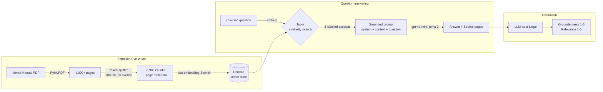

# 🩺 Medical RAG Assistant

A **Retrieval-Augmented Generation (RAG)** assistant that answers clinical questions using the
**Merck Manual of Diagnosis & Therapy**, citing the pages it used. It was built to help healthcare
professionals cope with information overload and get fast, evidence-based answers from a trusted source.

The project starts from a Jupyter notebook ([`notebooks/medical_assistant_rag.ipynb`](notebooks/medical_assistant_rag.ipynb))
and turns it into a re-usable Python package. It has a command-line tool, a Streamlit chat UI, an evaluation
harness and unit tests.

---

## 1. Problem statement

**Business context.** Clinicians face growing volumes of medical data and must make time-critical decisions.
Searching large references such as the 4,000-page Merck Manual by hand is slow, and general-purpose chatbots
answer from memory, give no citations and can hallucinate.

**Objective.** Build a RAG-based AI solution over a renowned medical manual that:

- **understands** the information-overload problem,
- **applies** AI (LLMs, embeddings and vector search) to streamline decision-making,
- **analyses** the effect on answer quality,
- **evaluates** whether it can standardise care information, and
- **creates** a working prototype.

**Use-case questions** (one per specialty):

| Specialty | Question |
|---|---|
| Critical Care | What is the protocol for managing sepsis in a critical care unit? |
| General Surgery | What are the common symptoms for appendicitis, and can it be cured via medicine? If not, what surgical procedure should be followed to treat it? |
| Dermatology | What are the effective treatments or solutions for addressing sudden patchy hair loss, commonly seen as localized bald spots on the scalp, and what could be the possible causes behind it? |
| Neurology | What treatments are recommended for a person who has sustained a physical injury to brain tissue, resulting in temporary or permanent impairment of brain function? |

**Data.** *The Merck Manual of Diagnosis & Therapy* is a PDF of over 4,000 pages in 23 sections. It covers
disorders, tests, diagnoses and drugs.

---

## 2. Solution overview

The project compares three approaches to the same questions:

| # | Approach | What it does |
|---|---|---|
| 1 | **Base LLM** | Sends the question straight to `gpt-4o-mini` |
| 2 | **Prompt engineering** | Adds a "medical research assistant" system prompt |
| 3 | **RAG** | Retrieves the most relevant manual excerpts and answers **only** from them, with page citations |



Read [docs/ARCHITECTURE.md](docs/ARCHITECTURE.md) for a component-by-component explanation.

---

## 3. Results

From the notebook run (4 questions, LLM-as-a-judge, scores from 1 to 5):

| Approach | Groundedness | Relevance |
|---|---|---|
| Base LLM | 5.00* | 3.67 |
| Prompt engineering | 4.25 | 4.50 |
| **RAG** | **4.50** | **5.00** |

\*The base LLM's perfect groundedness is misleading. It gives correct-sounding medical reasoning that is
*not* drawn from the manual, and some judge replies could not be parsed. Both problems are fixed in this
codebase (see [docs/EVALUATION.md](docs/EVALUATION.md)).

**Example RAG answer** (General Surgery):

> **Answer:** The common symptoms of appendicitis include epigastric or periumbilical pain followed by
> nausea, vomiting and anorexia, with pain shifting to the right lower quadrant… Appendicitis cannot be
> cured via medicine; the treatment is surgical removal, an open or laparoscopic appendectomy.
>
> **Source:** The Merck Manual of Diagnosis & Therapy, 19th Edition, Ch. 11, Acute Abdomen & Surgical Gastroenterology, p. 163.

### Key insights

1. **RAG has the best relevance (5.0/5).** Retrieval sends medical queries to the right sections of the manual.
2. **RAG answers can be traced.** Every answer cites manual pages, which no-retrieval answers cannot do. This is essential for clinical trust.
3. **Groundedness (4.5) is the main thing to improve.** Small 500-token chunks sometimes split a protocol across chunks, so the model fills gaps.
4. **Prompt engineering alone helps relevance (3.67 → 4.5)** but adds no evidence.

### Business recommendations

1. Use RAG over authoritative manuals as the default for clinical Q&A. Do not use bare LLMs.
2. Increase chunks to 800–1,000 tokens with 150–200 overlap, and add a **cross-encoder re-ranker** and hybrid (BM25 + vector) retrieval to raise groundedness.
3. Expand evaluation to a 30–50 question benchmark across specialties before any clinical pilot.
4. Make citations mandatory, with chunk IDs, page numbers and document metadata, for traceability and regulatory readiness.
5. Add safety guardrails, fallback responses and PHI-safe logging.
6. Standardise the answer format as **Assessment → Management → Red Flags → Evidence**.
7. Monitor groundedness, relevance, latency and token cost on a dashboard.

---

## 4. Project structure

```
medical-rag-assistant/
├── app.py                    # Streamlit chat UI
├── medical_rag/              # Core package
│   ├── config.py             # Settings (env-overridable) + the 4 use-case questions
│   ├── prompts.py            # System/user prompts for prompt-eng, RAG and the judges
│   ├── llm.py                # OpenAI client; base LLM + prompt-engineered answers
│   ├── ingest.py             # PDF -> chunks -> embeddings -> Chroma
│   ├── retriever.py          # Load store, top-k search, labelled context
│   ├── rag.py                # Retrieve + generate grounded, cited answer
│   └── evaluate.py           # LLM-as-a-judge: groundedness & relevance
├── scripts/
│   ├── ingest.py             # Build the vector store
│   ├── ask.py                # CLI Q&A (rag / compare modes)
│   └── evaluate.py           # Run the 3-way evaluation, save CSV
├── tests/test_pipeline.py    # Offline unit tests (no API key needed)
├── notebooks/                # Original analysis notebook with outputs
├── docs/                     # Architecture & evaluation write-ups
├── data/                     # Put the manual PDF here (git-ignored)
├── .vscode/                  # Run/debug configs for VS Code
├── requirements.txt
└── .env.example
```

---

## 5. Getting started

### Prerequisites
- Python 3.11–3.13
- An OpenAI API key, or a key for an OpenAI-compatible gateway
- The Merck Manual PDF (see [data/README.md](data/README.md))

### Setup (Windows PowerShell)

```powershell
git clone https://github.com/bks1984/medical-rag-assistant.git
cd medical-rag-assistant
python -m venv .venv
.venv\Scripts\Activate.ps1
pip install -r requirements.txt
copy .env.example .env      # then add OPENAI_API_KEY
```

macOS and Linux: run `source .venv/bin/activate` and `cp .env.example .env`.

### Build the knowledge base

Copy the PDF to `data/medical_diagnosis_manual.pdf`, then run:

```powershell
python scripts/ingest.py
# try a different chunking strategy:
python scripts/ingest.py --chunk-size 800 --chunk-overlap 150
```

### Ask questions

```powershell
streamlit run app.py                                         # chat UI
python scripts/ask.py "What are the symptoms of appendicitis?"
python scripts/ask.py --mode compare "How is sepsis managed?" # base vs prompt-eng vs RAG
python scripts/ask.py                                        # interactive
```

### Evaluate

```powershell
python scripts/evaluate.py                 # the 4 use-case questions
python scripts/evaluate.py --questions my_questions.json
```

The script writes `results/evaluation_<timestamp>.csv` and prints average scores for each approach.

### Test

```powershell
pytest -q
```

The tests run offline: they mock the LLM and the vector store.

### Configuration

All settings live in `.env`. See [.env.example](.env.example). The main ones are `CHAT_MODEL`,
`EMBEDDING_MODEL`, `CHUNK_SIZE`, `CHUNK_OVERLAP`, `TOP_K` and `OPENAI_BASE_URL`, which lets you use a proxy.

---

## 6. Tech stack

Python · OpenAI (`gpt-4o-mini`, `text-embedding-3-small`) · LangChain · ChromaDB · PyMuPDF · tiktoken · Streamlit · pandas · pytest

---

## ⚠️ Disclaimer

This is an educational prototype. It summarises reference text for healthcare professionals and is
**not** a medical device or a substitute for clinical judgement. Do not enter patient-identifiable information.
